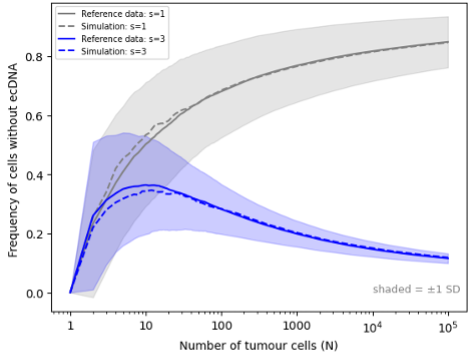

# Validating the model

This README file describes the steps taken to validate the basic ecDNA model before the addition of cell death, reintegration, and excision. 

## Why?
Within this project the effects of reintegration and excision on ecDNA population dynamics are examined. However, the basic mechanics of the model, such as establishing the known 
[two-state population](src/base_validation_model/result_1_1.png), will give confidence that the model works as intended before the addition of parameters or events. This is done by 
validating the model against an known published ecDNA model in current literature. If the current model produces similar results to that of a published ecDNA model, the base of the model
works accordingly and therefore, the addition of reintegration, cell death, and excision to the model. 

## How?
The [base model's](base_validation_model.py) output was compared against reference data from Lange and colleagues (2022), using the mean ecDNA-negative (ecDNA-) cell fraction under
neutral (s=1) and positive (s=3) selection. Simulations were also ran death-free, to match the framework of Lange and colleagues (2022) starting from a single ecDNA+ cell (one copy) and averaged across 100 independent runs.

! Selection parameter choices are made according to the reference data.

## Results
Under both selection regimes, the simulated curves closely tracked the reference data. The ecDNA- fraction had plateaued near zero under position selection (ecDNA+ dominates) and rose above 0.8 under 
neutral selection (ecDNA+ accumulates through one-directional loss). Wide standard deviation bands at small N narrow as the population grows and as averaging increases. 

  

> **Validation of the base model against Lange et al. (2022)**. The base model was validated by comparing its output (dashed lines) against reference data from Lange et al. (2022) (solid lines),
> using the mean ecDNA-negative (ecDNA-) cell fraction under neutral (s=1) (grey) and positive (s=3) (blue) selection, averaged across 100 death-free runs starting from a single ecDNA+ cell. *Generated by: [s1_s3_validation.py](s1_s3_validation.py)* 

## What does this tell us?

The simulated ecDNA- fractions closely matched the reference data under both selection regimes, this confirmed that the base model reproduces established ecDNA dynamics before the addition of death, 
reintegration, and excision, and therefore the addition of these processes can now be implemented.

## References
Lange, J.T. et al. (2022) ‘The evolutionary dynamics of extrachromosomal DNA in human cancers’, Nature Genetics, 54(10), pp. 1527–1533. Available at: https://doi.org/10.1038/s41588-022-01177-x.

